<p align="center">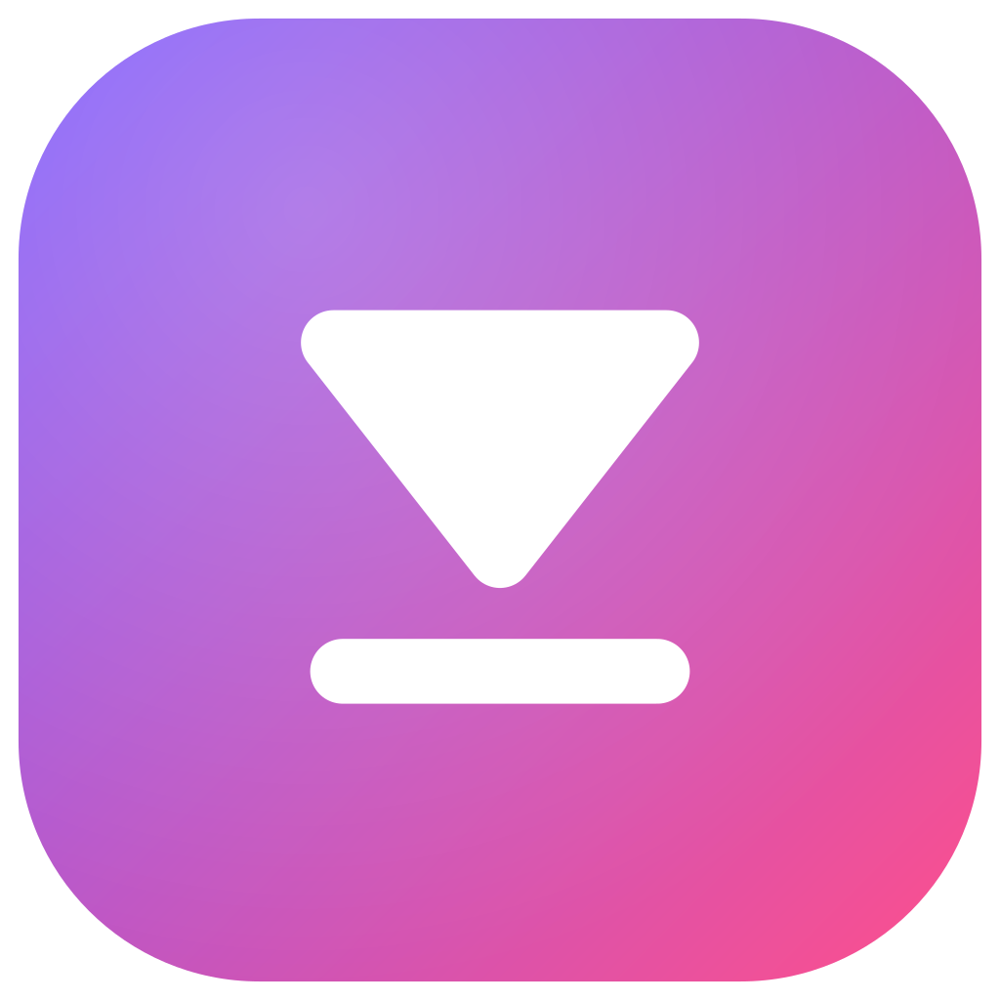</p>

<h1 align="center">DownVid</h1>

Open-source Android downloader for videos, music and photos from public links
(YouTube, YouTube Music, Instagram, Threads, TikTok, X/Twitter, Facebook, SoundCloud,
plain web pages with MP4/HLS players) — and music links from Spotify, Deezer
and Apple Music, matched to the same recording on YouTube Music.

A native Kotlin app (Jetpack Compose) with a **built-in browser** that lists
the videos of the page you are on and a **built-in player**, on top of a
**Go core** compiled as a native library (downloads, HLS, queue, metadata).

> **Use DownVid only with content that is your own, public, or that you are
> authorized to download**, respecting each platform's terms of service and
> copyright. You are responsible for how you use the downloaded files.

<p align="center">
  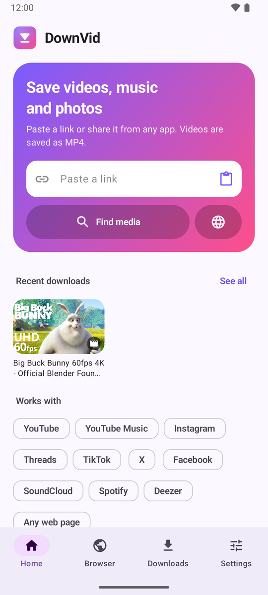
  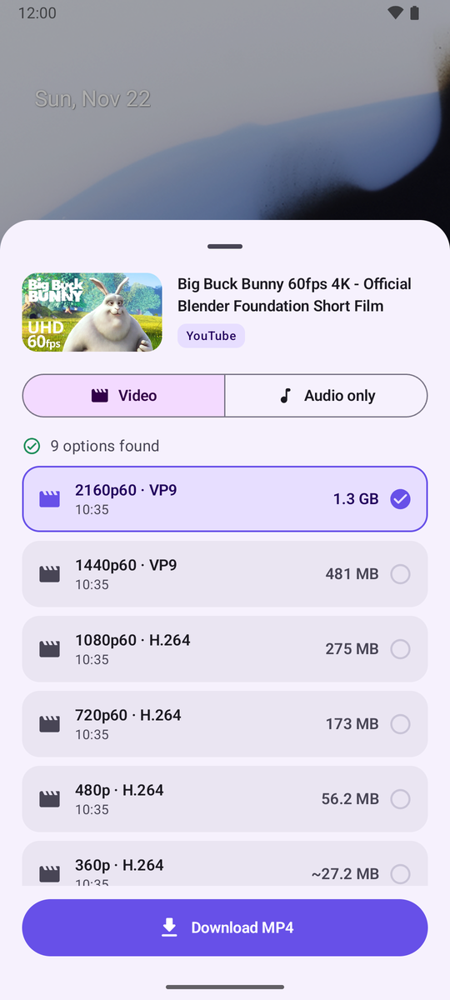
  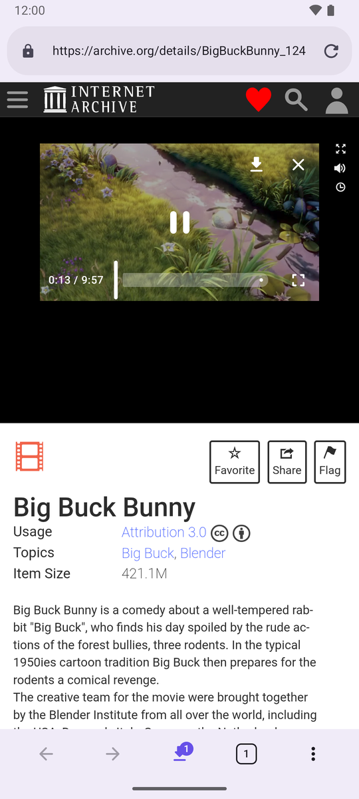
  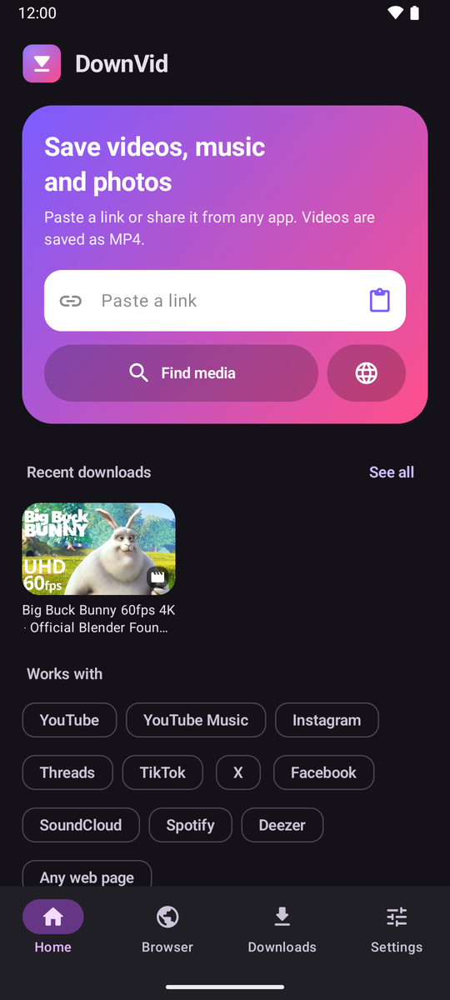
</p>

<p align="center">
  <a href="https://github.com/reinanbr/downvid/releases/latest/download/DownVid-arm64-v8a.apk"><b>⬇ Download the latest APK (arm64, most phones)</b></a>
  ·
  <a href="https://github.com/reinanbr/downvid/releases/latest">all files of the latest release</a>
</p>

---

## Contents

- [Download](#download)
- [Using DownVid](#using-downvid)
- [Features](#features)
- [How it works](#how-it-works)
  - [Architecture](#architecture)
  - [From a shared link to the download sheet](#from-a-shared-link-to-the-download-sheet)
  - [Extractors](#extractors)
  - [Downloading and muxing](#downloading-and-muxing)
  - [Audio only](#audio-only)
  - [Instagram](#instagram)
  - [Queue, resume and background downloads](#queue-resume-and-background-downloads)
  - [Storage and permissions](#storage-and-permissions)
  - [Privacy](#privacy)
- [Building](#building)
- [Testing](#testing)
- [Releases and CI](#releases-and-ci)
- [Project layout](#project-layout)
- [Debugging](#debugging)
- [Limitations](#limitations)
- [License and third-party software](#license-and-third-party-software)

---

## Download

Every version is built by CI and published on the
[Releases page](https://github.com/reinanbr/downvid/releases/latest), with one
APK per CPU type. The links below always point to the latest release:

| File | For |
|---|---|
| [`DownVid-arm64-v8a.apk`](https://github.com/reinanbr/downvid/releases/latest/download/DownVid-arm64-v8a.apk) | almost every phone from the last ~8 years — **pick this one if unsure** |
| [`DownVid-armeabi-v7a.apk`](https://github.com/reinanbr/downvid/releases/latest/download/DownVid-armeabi-v7a.apk) | older or low-end 32-bit phones |
| [`DownVid-x86_64.apk`](https://github.com/reinanbr/downvid/releases/latest/download/DownVid-x86_64.apk) | emulators and x86 Chromebooks |

1. Download the APK on the phone and open it.
2. Android asks to allow installs from your browser/file manager
   ("Install unknown apps") — allow it once, then tap **Install**.
3. Updates: install the newer APK over the old one; downloads and settings
   are kept (every release is signed with the same key).

Requires Android 7.0 or newer. `SHA256SUMS.txt` in each release lets you check
the files (`sha256sum -c SHA256SUMS.txt`).

## Using DownVid

### 1. First launch

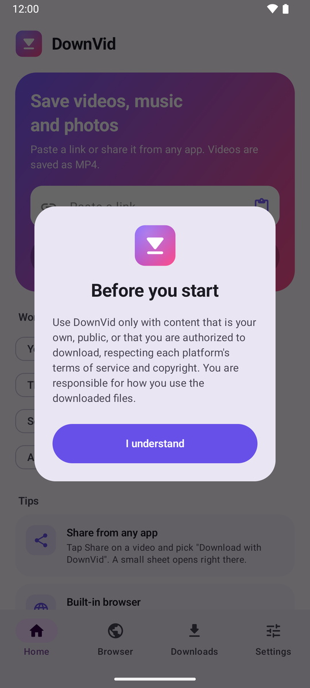

On the first launch DownVid shows a short usage notice: download only content
that is yours, public, or that you are authorized to download. Tap
**I understand** to continue. There is no account to create and nothing to
configure — the defaults work out of the box.

The home screen lists the supported sites and a few tips. The
**Recent downloads** row appears after your first download.

<br clear="right">

### 2. Get a link into DownVid

There are three ways, use whichever is handiest:

- **Share** — in YouTube, Instagram, TikTok, the browser, etc., tap
  *Share* and pick **Download with DownVid**. A small sheet opens on top of
  the app you are in; you never leave it.
- **Paste** — copy the link, open DownVid and paste it into
  *Paste a link* (the clipboard button pastes for you), then tap
  **Find media**. If you just copied a link, DownVid offers it as soon as it
  opens.
- **Quick Settings tile** — add the **Paste & download** tile to your
  notification shade and tap it after copying a link, from anywhere.

### 3. Choose what to save

| Video | Audio only | Saved |
|:---:|:---:|:---:|
| 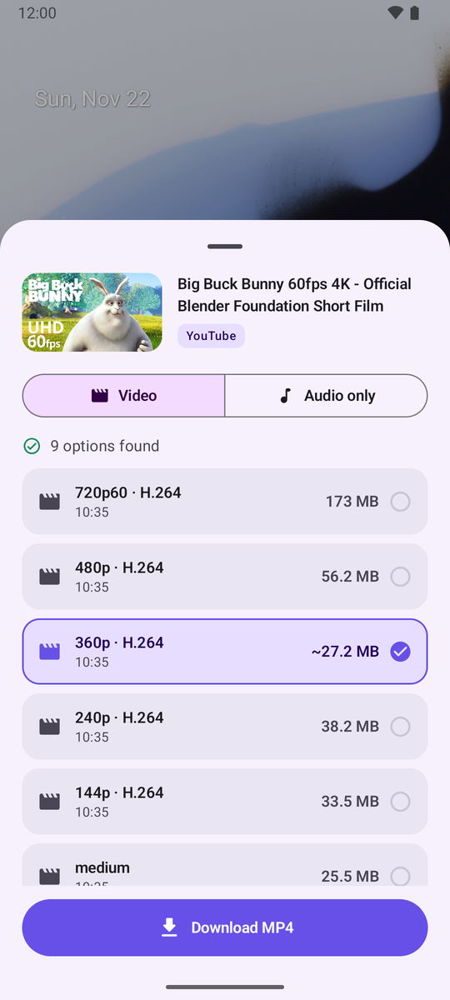 | 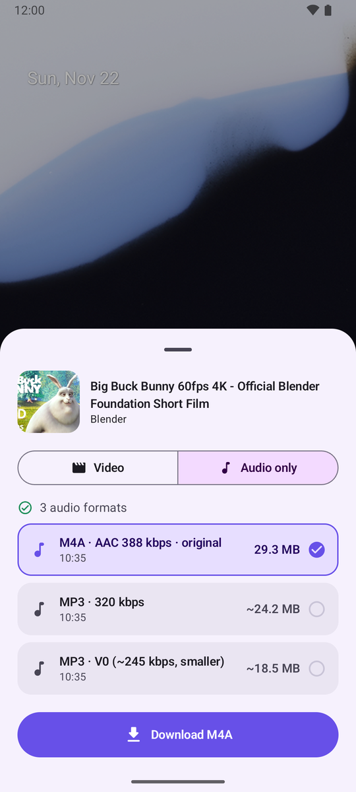 | 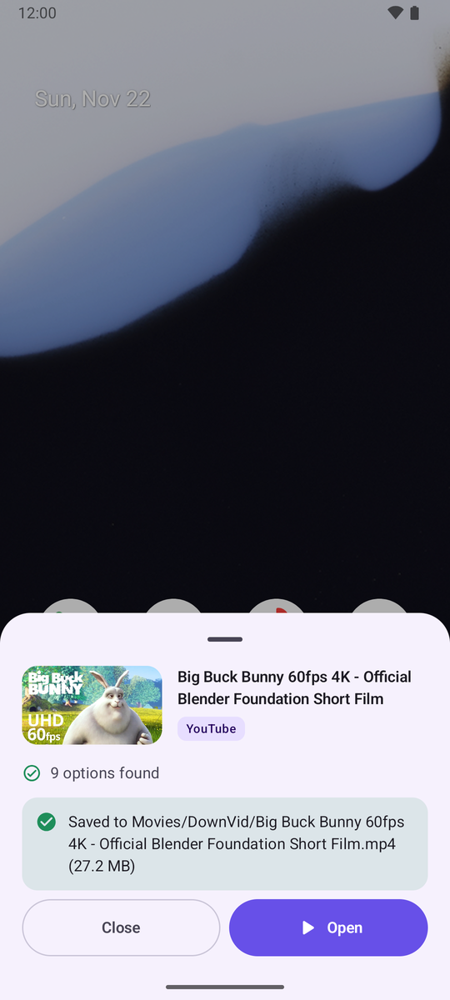 |

The sheet shows the thumbnail, the title and every available option with its
estimated size:

- **Video** — one entry per resolution. Everything is saved as **MP4**;
  up to 1080p the H.264 version is picked so it plays on any device.
- **Audio only** — **M4A original** (the source audio, no conversion: fastest
  and lossless) or **MP3** (320 kbps or V0). Title, artist, album and a
  square cover are written into the file. Music links (YouTube Music,
  SoundCloud, Spotify, Deezer, Apple Music) open here directly.
- **Photos** — Instagram/Threads photos and carousels show one entry per
  item with checkboxes, so you can pick only the ones you want.

Tap **Download**. You can close the sheet right away — the download keeps
going in the background with a progress notification (pause/cancel). When
it finishes, **Open** plays the file in DownVid's player.

> Instagram/Threads posts that are hidden from visitors (private accounts you
> follow, stories…) show an optional **Sign in** button. It opens the site's
> official login page; DownVid never sees your password and the session stays
> on the phone. You can sign out in Settings.

### 4. Find your files

| Downloads | Settings |
|:---:|:---:|
| 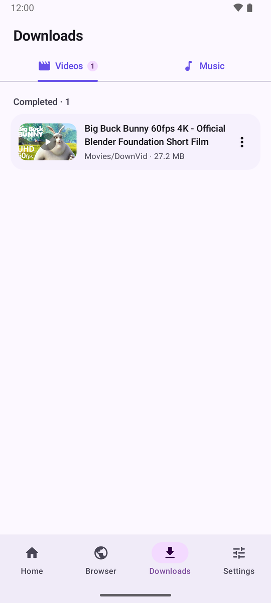 | 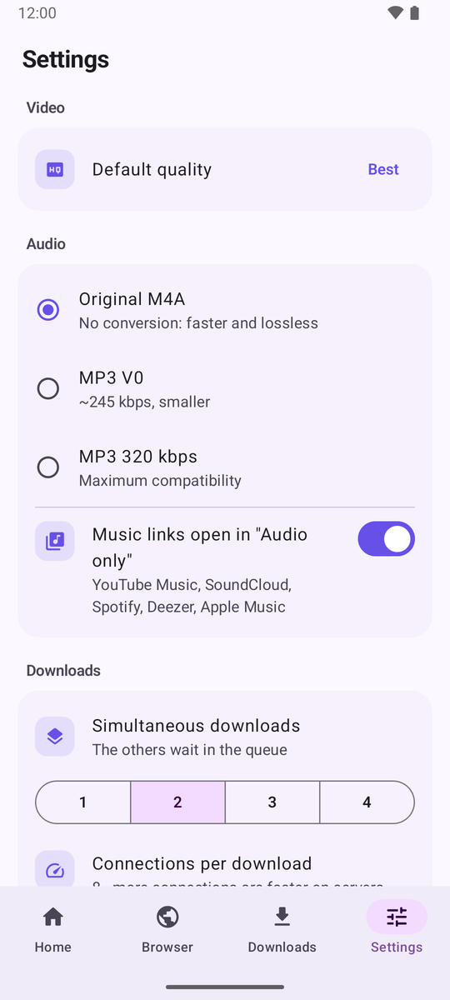 |

The **Downloads** tab (bottom bar) lists your downloads, split into Videos /
Music / Photos. Running downloads can be paused and resumed (even after the
app is closed or the network drops). Tap a finished video or song to play it
in DownVid's player; the ⋮ menu has **Open with…** (another app), **Share**,
**Remove from history** and **Delete file**.

Files go to the regular media folders, so they also show up in your gallery
and music player:

| Type | Folder |
|---|---|
| Videos | `Movies/DownVid` |
| Music | `Music/DownVid` |
| Photos | `Pictures/DownVid` |

The **Settings** tab: default video quality, default audio format, whether
music links open in *Audio only*, how many downloads run at once and how many
connections each uses, copied-link detection, the browser (search engine, ad
blocker, desktop sites, automatic player, background playback, clear browsing
data) and the yt-dlp extractor version (it updates itself every 3 days;
**Update** forces it).

### 5. Browse and play

| In-page player | Videos on this page | Player |
|:---:|:---:|:---:|
|  | 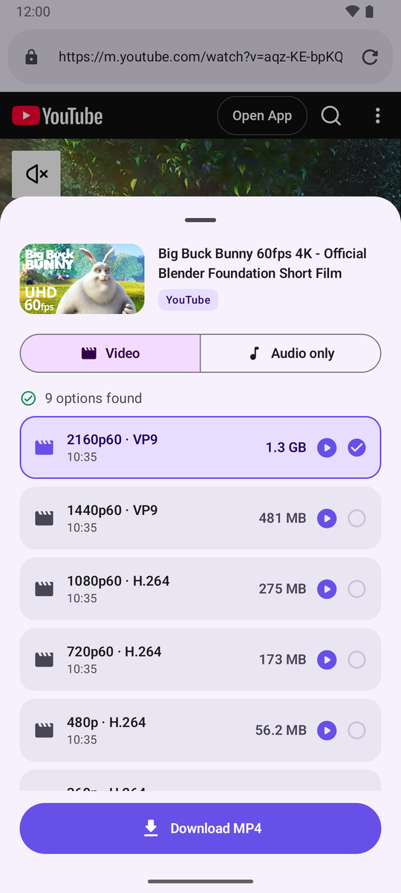 | 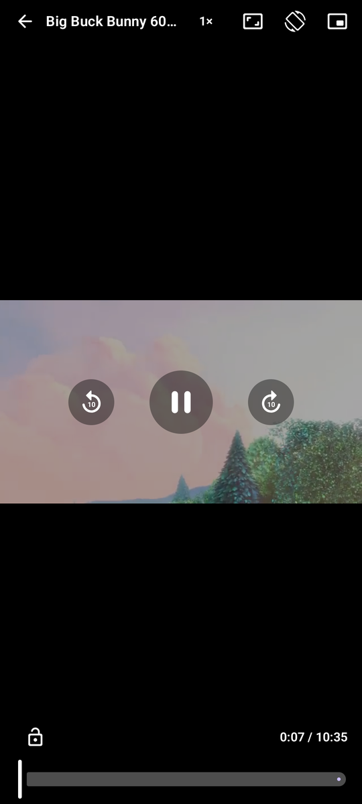 |

The **Browser** tab (or the globe button next to *Find media*) is a full
browser: tabs, private tabs, history, bookmarks and Brave's ad blocker. Web
links you open with DownVid land here too.

- Press play on a page's video and **DownVid's player plays it right there,
  in the page**, in place of the site's player (no ads, no pop-ups): tap it
  for play/pause, seeking, **download** and **fullscreen** (speed, lock,
  fit, rotation; the page stays open behind it). **×** gives the page its
  own player back. Prefer the site's player? Settings → *Open videos in the
  player* off turns this into a **Play in DownVid** button.
- The **download button** in the bottom bar counts the videos found on the
  page and opens the same download sheet, with a ▶ to preview each quality.
- Sites protected with DRM (streaming services, some Vimeo videos) play in
  their own player; DownVid shows a lock and offers nothing to download.

## Features

- **Share target**: share a link from any app → a translucent bottom sheet
  opens over that app (the full app does not open) with thumbnail, title,
  duration, quality list, estimated size and a download button.
- **Copied links**: when DownVid comes to the foreground it offers a link you
  just copied; a **Quick Settings tile "Paste & download"** does the same
  from anywhere.
- **Video**: one option per resolution (H.264 up to 1080p for compatibility,
  VP9/AV1 above), always saved as **MP4** — HLS (`.m3u8`, including AES-128)
  and separate video/audio streams are merged without re-encoding.
- **Audio only**: original M4A (no conversion) or MP3 V0/320 with title,
  artist, album, year, track number and an embedded square cover.
- **Photos**: Instagram photos and carousels (pick the items with checkboxes).
- **Generic pages**: finds every MP4/HLS video on a web page — in the HTML,
  inline scripts, metadata, iframes, and by watching what the page's player
  requests in a hidden WebView.
- **Downloads screen** (tabs Videos / Music / Photos): persistent queue,
  pause/resume, resume after the app is killed or the network drops,
  automatic renewal of expired links, history with open/share/delete.
- **Background downloads** with progress notifications (pause/cancel);
  parallel connections per file (1–16, Settings) speed up large downloads.
- **Browser**: tabs, private tabs, history and bookmarks, Brave's ad and
  tracker blocker (its engine and default lists, video ads included),
  desktop mode, and a **▶ N** button that counts the videos of the
  page you are on (HLS, MP4, the streams its player loads) and lists them
  with **Download** and **Play**. "Download link…" takes any media URL with
  its Referer, User-Agent and Cookie.
- **Player**: plays page videos and downloads (HLS, DASH, MP4) with
  double-tap and swipe seeking, swipe brightness/volume, hold for 2×, speed,
  lock, fit/stretch/zoom, picture-in-picture, background audio and a
  remembered position. A video you start on a page plays in it at once,
  in the page, in place of the site's player (Settings can turn that into
  a "Play in DownVid" button); fullscreen keeps the page open underneath.
  It starts in portrait; the rotate button switches to landscape.
- **Settings**: default video quality, default audio format, "music links
  open in Audio only", simultaneous downloads, connections per download,
  copied-link detection, browser (search engine, ad blocker, desktop sites,
  automatic player, background playback, clear browsing data), yt-dlp
  version and update.

## How it works

### Architecture

DownVid is two layers running in **one Android process**:

- **Kotlin** (Jetpack Compose) draws every screen and owns everything that
  needs Android: the share entry point, the browser and its WebViews, the
  player (Media3), the resident yt-dlp process, the foreground services,
  notifications and MediaStore. It classifies links, picks the extraction
  route, merges the options and starts downloads.
- **The Go core** (`libdvcore.so`) does the heavy work that does not need
  Android: page scanning, turning extractor output into options, HTTP and HLS
  downloads, muxing, music metadata and the persistent download queue.

```
┌──────────────────────────────── Kotlin (Jetpack Compose) ─────────────────────────────────┐
│ MainActivity   Home · Browser · Downloads · Settings      ShareActivity  download sheet   │
│ browser/  BrowserModel (tabs, WebViews) · MediaDetector · AdBlocker · InlinePlayer        │
│ player/   PlayerActivity · PlayerHub (ExoPlayer) · PlaybackService (media session)        │
│ extract/  Extractor (route, options, download start) · LinkParser · LinkRenewer           │
│ core/     GoCore (typed calls) · JobController (the job feed) · Settings                  │
│ YtDlp(Server) resident yt-dlp · PageSniffer / InstagramQuery hidden WebViews              │
│ DownloadService (foreground) · MediaSaver (MediaStore)                                    │
└──────────────┬────────────────────────────────────────────────────────────────────────────┘
               │ JNI: DvCore.nativeCall(method, JSON) → {"ok", "data" | "error"}
┌──────────────▼─ Go core: libdvcore.so ─┐
│ scan       generic page scan, probing  │
│ ytdlp      yt-dlp JSON → options       │
│ instagram  Instagram + Threads posts   │
│ music      tags, music-link matching   │
│ hls        m3u8, AES-128, segments     │
│ netx       ranged, resumable HTTP      │
│ media      ffmpeg / pure-Go remux      │
│ jobs       persistent download queue   │
└──────────────┬─────────────────────────┘
               │ os/exec, files                      child process, MediaStore
               ▼                                     ▼
       ffmpeg (libffmpeg.so)                   Python + yt-dlp + QuickJS
       files/jobs/jobs.json                    Movies|Music|Pictures/DownVid
       no_backup/downloads/                    notifications
```

#### Who does what

| Layer | Owns | Talks to |
|---|---|---|
| Kotlin | Screens; link classification (`LinkParser`); extraction route, option merging and download start (`Extractor`); renewal of expired links (`LinkRenewer`); the browser (`browser/`), the player (`player/`), yt-dlp (`YtDlp`, `YtDlpServer`), hidden WebViews (`PageSniffer`, `InstagramQuery`), `DownloadService`, `MediaSaver` | The Android SDK, the yt-dlp child process, and Go through JNI (`GoCore`) |
| Go core | Page scan, option building, downloads (`netx`, `hls`), ffmpeg and remux (`media`), music metadata, **the job queue** (`jobs`, persisted in `files/jobs/jobs.json`) | The network, ffmpeg (`os/exec`) and its own files; it never calls Android APIs |

#### One process, one Go runtime

- The Go core is built with `-buildmode=c-shared` for `arm64-v8a`,
  `armeabi-v7a` and `x86_64` (`scripts/build_go.sh`, run automatically by
  Gradle). Kotlin reaches it through **one** JNI function,
  `DvCore.nativeCall(method, request)`: UTF-8 JSON in, a
  `{"ok":…,"data"|"error":…}` envelope out. `GoCore` wraps each method in a
  typed Kotlin call (`probe`, `ytdlp`, `download`, `pause`, `replace`…).
- **`JobController` is the only owner of the job feed**: one long-poll
  (`jobs.Await`, 30 s, at most every 250 ms) runs only while something
  collects `JobController.jobs` — the Downloads screen, an open download
  sheet, `DownloadService` — so an idle app does no polling at all. Every
  mutation (download, pause, resume, renew…) goes through it, and it starts
  `DownloadService` whenever a job becomes active.
- Threads: the main thread never blocks. Blocking Go calls run on
  `Dispatchers.IO`, each download is a set of goroutines, and MediaStore
  writes happen on a background thread. yt-dlp runs in a separate Python
  process that stays warm between extractions.
- [youtubedl-android](https://github.com/JunkFood02/youtubedl-android)
  provides Python, yt-dlp, QuickJS and ffmpeg for Android. DownVid only uses
  yt-dlp to **extract** (`-J`); downloading and muxing happen in Go.

#### Life of a download

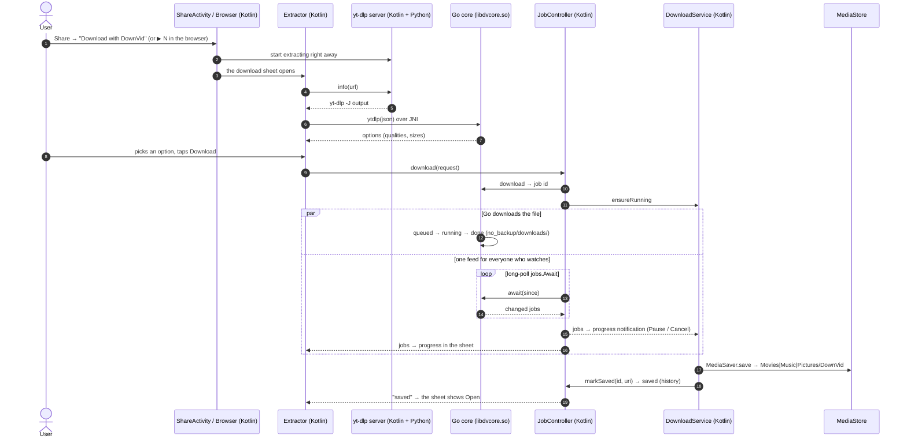

Go owns the bytes until the file is complete (state `done`, file in the
app's private `no_backup/downloads/`). **Only `DownloadService` publishes
it**: it copies the file to MediaStore, deletes the private copy and records
the gallery URI with `markSaved`, which turns the job into history
(`saved`). The sheet only watches; closing it never stops the job.

#### Job states

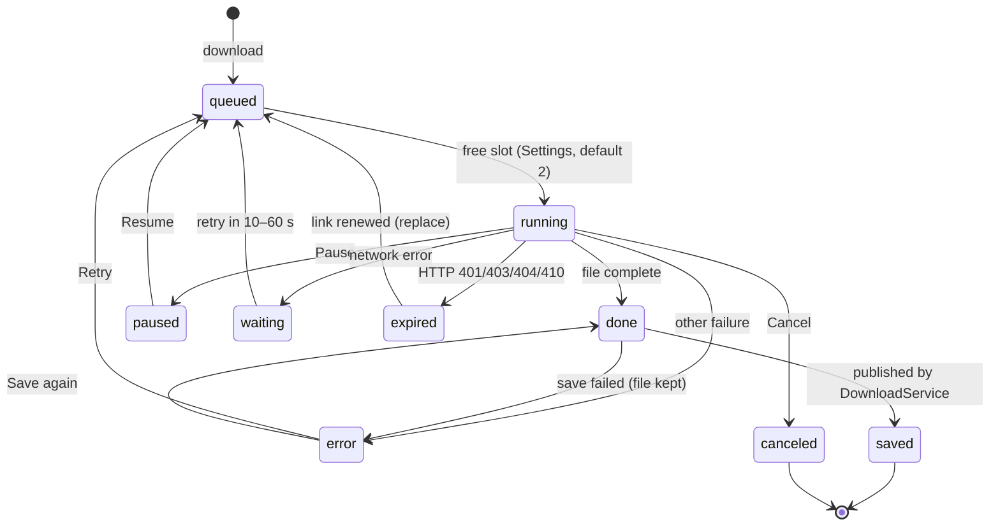

- Every transition is written to `files/jobs/jobs.json` (atomically; progress
  every 3 s). On start, `running` and `waiting` jobs go back to `queued` and
  continue from their partial data; a `done` job whose file is gone becomes
  `error`.
- `DownloadService` runs while any job is `queued`, `running`, `waiting` or
  `done`, and stops when the queue is idle (or when Android 15's daily
  `dataSync` limit is hit). Jobs can become active while it is stopped
  (Resume/Retry on the Downloads screen, a renewed link), so the UI starts it
  again whenever a job enters one of those states. Without that, a finished
  file would sit in `done` ("Saving to gallery…") until the app restarted.
- A save that fails moves the job to `error` with `saveFailed` set and keeps
  the downloaded file. The service does not retry it on its own, because a
  save that fails once usually fails every time. **Save again** on the
  Downloads screen puts the job back in `done`, and the file is published
  without downloading it again.

### From a shared link to the download sheet

`ShareActivity` receives `ACTION_SEND text/plain`, shows the download sheet
in a transparent window over the calling app, and starts yt-dlp extraction
right away (while the sheet is still being drawn). The link is classified
(`LinkParser`) and `Extractor` picks a route:

| Link | Route |
|---|---|
| Spotify / Deezer / Apple Music | Read track metadata from the service → search YouTube Music → accept the first result with the same duration (±5 s) |
| Instagram post/reel/story | Instagram's own post query in a WebView (see [Instagram](#instagram)); yt-dlp as fallback |
| Threads post | The post page opened in a WebView; Go reads the post from the data the page embeds (Instagram's media schema, quotes/reposts included), or from the post data the page fetches; optional login (Threads' official page) for posts hidden from visitors |
| YouTube, TikTok, X, Facebook, SoundCloud… | yt-dlp; if it does not support the link, falls back to the generic scan |
| Any other page | Generic scan **and** yt-dlp in parallel (yt-dlp has extractors for thousands of sites and embedded players) |

The **generic scan** has two halves running in parallel:

1. **Static (Go, `scan`)**: downloads the HTML and extracts candidates from
   `<video>`/`<source>`, `og:video`, JSON-LD `contentUrl`, absolute and
   relative URLs ending in `.mp4/.m3u8/.m4v/.mov` inside scripts (with
   `\/`, `/` and percent-encoding undone), and iframes one level deep
   (with the iframe as `Referer`).
2. **Dynamic (Kotlin, `PageSniffer`)**: loads the page in a hidden WebView
   (laid out behind the activity's content, almost transparent), mutes and plays
   videos, presses common "big play" buttons and records every media request
   (`shouldInterceptRequest`, Resource Timing). This finds players that load
   their streams with JavaScript (hls.js, video.js, JW Player…).

Every candidate is **resolved** in Go: HLS master playlists expand into one
option per variant (resolution, bitrate, estimated size from bandwidth ×
duration), live streams and DRM are rejected with a reason, direct files are
probed (`Range: bytes=0-0`) for type and size; WebM/OGG are skipped because
they cannot be saved as MP4 without re-encoding, and files under 1 MB
(previews, stream fragments) are hidden when the page has a real video.

### Extractors

- **yt-dlp** runs inside a **resident Python process** (`YtDlpServer.kt` +
  `assets/ytdlp_server.py`): starting Python and importing yt-dlp costs ~7 s
  on a phone, so the server pays it once (right after install/update via
  `UpdateReceiver`, or when the app opens) and then answers JSON requests over
  stdin/stdout; it stops after 5 idle minutes. If it fails, a one-shot
  `yt-dlp -J` process is used.
- YouTube's JavaScript challenges are solved with the **QuickJS** binary that
  ships with youtubedl-android (`--js-runtimes quickjs:…`); yt-dlp updates
  itself to the latest stable release every 3 days.
- `go/internal/ytdlp` turns yt-dlp's JSON into options: one per height,
  preferring H.264 up to 1080p (plays everywhere), VP9 above (wide hardware
  support), direct HTTPS over HLS (faster), the best AAC audio for merges, and
  watermark-free copies; Facebook's progressive `hd`/`sd` files are kept as
  "HD · MP4"/"SD · MP4". yt-dlp's per-format headers and cookies are passed
  to the downloader (quoted cookie values are unquoted — TikTok rejects them
  otherwise). yt-dlp errors are translated into short messages per platform
  (private, age-restricted, login required, rate-limited, geo-blocked, DRM…).

### Downloading and muxing

- **Direct files** (`netx`): parallel HTTP Range download in 4 parts for
  files ≥ 4 MB, with each request capped at yt-dlp's `http_chunk_size`
  (10 MB for YouTube, which throttles larger ranges), retries with backoff
  that resume from the exact byte. On the desktop this is ~35% faster than
  yt-dlp's own downloader for the same file.
- **Separate video + audio** ("merge"): both streams are downloaded in
  parallel, then `ffmpeg -c copy -movflags +faststart` joins them into MP4.
- **HLS**: segments are fetched by 6 workers, AES-128 segments decrypted
  (key cache, IV from the playlist or the media sequence number), byte-range
  segments supported; separate audio renditions are downloaded too. The
  segments of each rendition are concatenated (fMP4 with its init section)
  and **ffmpeg copies them into MP4** — it handles every HLS flavor,
  including the negative composition offsets used by X/Twitter. A pure-Go
  remuxer (`media`, based on a vendored and patched
  [gomedia](https://github.com/yapingcat/gomedia)) is the fallback.
- The ffmpeg used on the device is youtubedl-android's (`libffmpeg.so` in
  `nativeLibraryDir`), executed by Go with `os/exec`.

### Audio only

- Options (`ytdlp/audio.go`): **M4A original** (the AAC stream copied as is —
  instant and lossless), **MP3 320** and **MP3 V0** encoded from the best
  source (usually Opus); MP3 sources are copied.
- One ffmpeg pass converts/copies, embeds the cover (16:9 thumbnails are
  center-cropped to a square, up to 1000 px) and writes the tags, with real
  progress (`-progress`).
- **Metadata** (`go/internal/music`): YouTube Music's track/artist/album when
  present; otherwise the cleaned title ("(Official Video)", "[Lyrics]"…
  removed) split as "Artist - Title". **iTunes and Deezer are queried in
  parallel** and a result is accepted only if the duration matches within
  ±3 s and title/artist are similar; iTunes usually gives the original album,
  Deezer fills the gaps (ISRC). Without a match, the "Artist - Title" split
  is kept only for music links (YouTube Music, SoundCloud); otherwise the
  full title and the channel are used.
- **Spotify/Deezer/Apple Music**: their audio is DRM-protected, so DownVid
  reads the track metadata (Spotify embed page, Deezer API, iTunes lookup),
  searches YouTube Music and verifies the duration of the candidate before
  downloading it; live/remix/cover versions are penalized unless requested.

### Instagram

- **Public posts and reels, no login**: the app opens the post page in a
  hidden WebView (a real Chrome, presented as the desktop build so Instagram
  serves the highest renditions), reads the page's session token and the
  current query id, and runs the same logged-out post query the website runs
  for visitors (`/api/graphql`). `go/internal/instagram` parses the answer:
  DASH renditions (video + audio track, up to 1440p VP9), the progressive
  H.264 MP4 ("compatible"), photos, carousels (one option per item, with
  checkboxes) and the audio track for "Audio only". Media files are then
  downloaded by Go from Instagram's CDN, which needs no session.
- **Optional login, only offered for private content**: Instagram hides some
  posts from logged-out visitors (private accounts you follow, accounts of
  minors, sensitive content) and always hides stories. Only then the sheet
  offers "Sign in to Instagram (optional)": `InstagramLoginActivity` shows
  Instagram's **official login page**; the app never sees or stores the
  password — it only detects that the session cookie exists. The session
  lives in the app's private WebView cookie store, never leaves the device,
  and is used only when the public query is refused (`/api/v1/media/{id}/info/`
  for posts, `/api/v1/feed/reels_media/` for stories). Sign out in Settings.

### Threads

- **Public posts, no login**: Threads posts use Instagram's media schema.
  `InstagramQuery` (mode `threads`) opens the post page in the hidden WebView;
  share links (`threads.com/share/...`) redirect to the post and the code is
  read from the final URL. The post comes from the data the page embeds
  (`<script type="application/json">`) or, when the page loads it later, from
  the page's own GraphQL responses (kept by a document-start script,
  `androidx.webkit`). `go/internal/instagram/threads.go` finds the post by
  code and reuses the Instagram parser: DASH renditions, the H.264 MP4,
  photos, carousels and audio; quotes/reposts offer the shared post's media.
- **Optional login**: some posts are hidden from visitors (restricted
  profiles, sensitive content). The sheet then offers "Sign in to Threads
  (optional)": the same login activity shows Threads' official login page,
  and the query WebView uses the session from the app's cookie store. Sign
  out in Settings.

### Browser

`browser/` is a WebView browser built around finding media:

- **Tabs**: at most 6 WebViews stay alive; older tabs keep only their saved
  state and reload when selected. Open tabs, history (1000 entries) and
  bookmarks are JSON files under `files/browser/`, written off the main
  thread. Pages run only while the browser is on screen.
- **Private tabs** use a separate WebView profile (`androidx.webkit`
  `ProfileStore`), a new one per private session: they share nothing with
  normal tabs or with earlier private sessions, write no history, and their
  cookies and storage are wiped when the last private tab closes (the empty
  profile folder is deleted at the next start, the only time Chromium
  allows it).
- **Ad and tracker blocker**: Brave's engine,
  [adblock-rust](https://github.com/brave/adblock-rust), in a small Rust
  library (`adblock/`, `libdvadblock.so`, JNI) with Brave Shields' default
  lists (every default list of Brave's catalog plus the Portuguese/Spanish
  regional one: EasyList, EasyPrivacy, uBlock Origin's lists, Brave's own,
  ~215 000 rules), compiled ahead of time into `assets/adblock/engine.dat`
  (loaded in ~140 ms in the background when the browser opens). It works as
  in Brave:
  - **network**: every request of a page is checked with its type (taken
    from its Accept/Range headers or extension: WebView does not say it)
    and the page as source; blocked ones get an empty response, and
    `$redirect` rules get uBlock Origin's neutral resources instead (an
    empty video for a video ad, a no-op script), so players carry on;
  - **cosmetic**: before a page loads, its site's hiding rules and
    scriptlets are registered as a document-start script for its origin
    (CSS through a constructed stylesheet, which page CSP does not block);
    the classes and ids that appear on the page are sent to the engine,
    which answers with the generic rules matching them
    (`hidden_class_id_selectors`), unless the site has `$generichide`.
  Any site can be allowed from the menu.
- **Media detection** (`MediaDetector`, one per tab) gathers candidates from
  three places: every request the page makes (`shouldInterceptRequest`), a
  script injected at document start in every frame (`INJECTED_JS`: fetch/XHR
  requests and response types, `<video>`/`<source>` sources, MediaSource use,
  DRM requests and play events, reported through a `WebMessageListener`),
  and files the page offers to download. Segments are ignored; manifests and
  files are batched for 400 ms and resolved by the Go core with the tab's
  session (Cookie, Referer, User-Agent): one option per HLS variant, sizes,
  previews flagged; posters and scripts whose folder is named like a video
  (`.../clip.webm/poster.jpg`) are not candidates. The **▶ N** button opens
  the download sheet seeded with what was found (yt-dlp runs alongside, with
  the tab's cookies).
- **Play events** are caught on the document and on every shadow root as the
  page creates it (`attachShadow` hook): `play` does not leave a web
  component, and players such as archive.org's live in one. For a
  `blob:`/MediaSource player, the URL played is the page's **master**
  playlist (all qualities), also when the variant the player picked is not
  among the master's listed options.
- **DRM**: protected media (Widevine) is allowed for the page's own player
  (`onPermissionRequest`), so DRM sites play as in Chrome; such a page (EME
  requested, or a protected-media permission asked) is marked, nothing is
  offered for download or taken over, and the toolbar shows a lock. DownVid
  never touches encrypted streams.

### Player

- `PlayerHub` keeps **one** ExoPlayer for the process. `PlayerActivity` shows
  it (a `PlayerView` surface under Compose controls); `PlaybackService`
  (a Media3 `MediaSessionService`) wraps it in a media session for the
  notification, lock screen, headsets and PiP buttons, and keeps audio going
  with the screen off when "Background playback" is on.
- Requests carry the page's session (User-Agent, Cookie, and Referer/Origin
  as a browser sends them: only the page's origin to another site) and go
  over HTTP/2 or QUIC through the system's Cronet (`HttpEngine`, Android
  14+): some CDNs refuse HTTP/1.1; separate video/audio formats play through
  a `MergingMediaSource`; HLS and DASH work even without an extension in the
  URL.
- A video the user starts on a page is paused by the injected script in its
  own `play` event (before a frame or a sound) and plays in DownVid's
  player **inside the page** (muted previews, short clips and videos that
  start on their own are left alone); for `blob:`/MediaSource players the
  manifest the page loaded is played (its master playlist when known),
  waiting a moment for it; without a playable URL or with DRM the page's
  video resumes. With the automatic player off, a "Play in DownVid" button
  appears instead.
- In-page player (`InlinePlayer`): a `PlayerView` drawn over the page's
  `<video>`, which stays paused and muted underneath. The script reports
  the element's box in document CSS px (from frames, relayed by each parent
  frame) when it moves or resizes (`ResizeObserver`, scroll, a 0.7 s
  check); the app places the view at box × device-pixel ratio minus the
  WebView's scroll, applied at layout time, so it follows scrolling without
  waiting for the page. It has play/pause, seeking, a download button and
  fullscreen, which shows the full player UI (gestures, speed, lock, fit,
  rotation) within the browser screen, starting in portrait. Closing it
  hands the page its player back (paused); navigating, switching tabs or
  the element leaving the page closes it. It pauses when the browser leaves
  the screen.
- The position is remembered per page (not for private tabs) and the player
  has a download button that opens the same sheet. In `PlayerActivity`
  (downloads, the sheet's **Play**), leaving the app while a video plays
  enters picture-in-picture; closing the PiP window or the player releases
  the decoder and stops the service.

### Queue, resume and background downloads

- `go/internal/jobs` keeps a **persistent queue** in `files/jobs/jobs.json`
  (atomic writes): states `queued → running → done → saved`, plus `paused`,
  `waiting` (no network), `expired`, `error`, `canceled`; at most N downloads
  run at once (Settings, default 2).
- **Resume**: ranged downloads store each part's position in
  `<file>.dvstate`; HLS segments already fetched are reused; the finished
  input of a two-input job (video + audio) is not fetched again when the
  other one resumes; pausing or losing the process keeps partial data (only
  "cancel" deletes it).
- **Faster downloads**: large files are split into ranges fetched over up to
  16 connections (Settings, default 8); a slow range is taken over by a free
  connection, and servers that refuse ranges fall back to one stream.
- **No network**: the job waits and retries by itself (10–60 s, up to 60
  times), continuing where it stopped.
- **Expired links** (HTTP 401/403/404/410 from signed CDN URLs): the
  Downloads screen extracts the original link again, finds the same choice
  (`optionKey`: kind, quality, codec, format, carousel item) and swaps the
  URLs (`replace`) keeping the partial files.
- When the app starts, `GoCore.ensureInit` loads the queue and resumes what
  was pending. `DownloadService` (foreground service, type `dataSync`)
  follows `JobController.jobs`, shows per-download notifications with
  Pause/Cancel (at most one update per second), publishes finished files and
  records them in the history, and stops when nothing is active. Closing or
  hiding the sheet never cancels a download. See [Job states](#job-states)
  for when the service runs and how failed saves are retried.
- Gallery file names come from the title, cut to 80 characters and 180
  UTF-8 bytes without splitting an emoji. MediaStore rejects names that end
  in half of a surrogate pair.

### Storage and permissions

- Files are published with **MediaStore** (no storage permission on
  Android 10+): videos → `Movies/DownVid`, audio → `Music/DownVid`, photos →
  `Pictures/DownVid`. Android 7–9 write the file directly
  (`WRITE_EXTERNAL_STORAGE`, `maxSdkVersion=28`).
- Permissions: `INTERNET`, `FOREGROUND_SERVICE(_DATA_SYNC, _MEDIA_PLAYBACK)`,
  `POST_NOTIFICATIONS` (asked on the first download), `WAKE_LOCK`. Web pages
  get no camera, microphone or location access.
- The clipboard is read only while the app has focus (Android 10+ forbids
  background reads); the app first checks the clip's timestamp, which does
  not trigger Android's "pasted from clipboard" toast, and reads the content
  only when something new was copied.

### Privacy

DownVid has no server, account, analytics or ads. Everything runs on the
device; network requests go only to the sites you download from and, for
music metadata, to the public iTunes Search and Deezer APIs.

## Building

Requirements:

| Tool | Version |
|---|---|
| JDK | 17+ with `javac` (21 recommended; Android Studio's bundled JBR works) |
| Go | 1.26+ |
| Rust | stable, with the Android targets (`rustup target add aarch64-linux-android armv7-linux-androideabi x86_64-linux-android`) |
| Android SDK + NDK | compileSdk 37, NDK 28.2.13676358 |

```bash
cd android

# Debug APK (Gradle runs scripts/build_go.sh and scripts/build_rust.sh incrementally)
./gradlew :app:assembleDebug
# Smaller and faster: only the device's ABI (Go core, yt-dlp, ffmpeg)
DV_ABI=arm64-v8a ./gradlew :app:installDebug

# Release APKs, one per ABI
DV_SPLIT=1 ./gradlew :app:assembleRelease
# Release code signed with the debug key: installs over a debug build
# (keeping the data) to measure start-up and memory
DV_ABI=arm64-v8a ./gradlew :app:installBenchmark
```

The version comes from `android/gradle.properties` (`dv.versionName`,
`dv.buildNumber`), or `DV_VERSION` / `DV_BUILD_NUMBER`. Per-ABI version codes
are `abi × 1000 + build` (armeabi-v7a 1, arm64-v8a 2, x86_64 4), the same
scheme as earlier releases, so installed copies update in place.

The Go core can be built on its own:

```bash
scripts/build_go.sh                  # arm64-v8a armeabi-v7a x86_64
scripts/build_go.sh arm64-v8a        # one ABI
DV_VERSION=1.2.3 scripts/build_go.sh # version embedded in the library
```

The libraries are 16 KB page-aligned (required on Android 15+ devices).
New Go methods are added to the `nativeCall` dispatcher in
`go/dvcore/main.go` and wrapped in `GoCore.kt`.

The ad blocker (`adblock/`, Rust) is built by Gradle with
`scripts/build_rust.sh` (needs `rustup target add aarch64-linux-android
armv7-linux-androideabi x86_64-linux-android`). Its lists are rebuilt from
Brave's catalog with `scripts/build_adblock_lists.py` (cargo, node ≥ 22,
git; writes `assets/adblock/engine.dat` and `resources.json`; uBlock Origin's
scriptlets are converted with Node's permission model, read-only).

**Release signing**: put `android/key.properties` (git-ignored) with
`storeFile`, `storePassword`, `keyAlias`, `keyPassword`, or set
`DV_KEYSTORE_PATH`, `DV_KEYSTORE_PASSWORD`, `DV_KEY_ALIAS`,
`DV_KEY_PASSWORD`. Without them, release builds are signed with the debug key.

## Testing

```bash
cd android && ./gradlew :app:testDebugUnitTest   # Kotlin (link parser, request types, URL rules)
cd go && go vet ./... && go test -race ./...
cd adblock && cargo test --release                 # ad blocker, including the bundled engine

# Tests that reach the network (iTunes/Deezer/Spotify lookups)
cd go && DV_NET=1 go test ./internal/music -run Net -v
# Check option selection against a real `yt-dlp -J` dump
cd go && DV_YTDLP_JSON=/path/dump.json go test ./internal/ytdlp -v
```

`go/cmd/dvcli` exercises the core on a desktop (some commands need `yt-dlp`
and `ffmpeg` on the PATH):

```bash
cd go
go run ./cmd/dvcli probe <page-url>                       # generic scan
DV_FFMPEG=/usr/bin/ffmpeg go run ./cmd/dvcli get <url> 0 out.mp4
DV_YTDLP=$(which yt-dlp) go run ./cmd/dvcli ytdlp <url> 2 out.mp4
DV_YTDLP=$(which yt-dlp) go run ./cmd/dvcli audio <url> 0 out.m4a
```

Simulate a share, or open a page in the browser, on a device or emulator:

```bash
adb shell am start -a android.intent.action.SEND -t text/plain \
  --es android.intent.extra.TEXT "'https://www.youtube.com/watch?v=aqz-KE-bpKQ'" \
  -n com.downvid.downvid/.ShareActivity
adb shell am start -a android.intent.action.VIEW \
  -d https://test-streams.mux.dev/x36xhzz/x36xhzz.m3u8 -n com.downvid.downvid/.MainActivity
```

## Releases and CI

`.github/workflows/ci.yml`:

- **Every push and pull request**: `go vet`, `go test -race`, the Rust
  tests (`cargo test`), the Kotlin unit tests, and a debug build (arm64) to
  catch Android/Go/Rust build breakages.
- **Tags `v*`** (e.g. `v0.2.0`): builds the signed release APKs per ABI
  (`DownVid-arm64-v8a.apk`, `DownVid-armeabi-v7a.apk`, `DownVid-x86_64.apk`:
  the same names in every release, so
  `releases/latest/download/DownVid-<abi>.apk` always serves the newest
  one; the version is in each file's label) with SHA-256 checksums, and publishes
  a GitHub Release whose notes are the matching section of
  [`CHANGELOG.md`](CHANGELOG.md) (GitHub's generated notes when there is
  none). Tags with a suffix (`v1.0.0-beta.1`) become pre-releases. If the
  release was created on GitHub's site, the APKs are attached to it and its
  notes are kept.

To sign release APKs in CI, add these repository secrets (otherwise the APKs
are signed with a throwaway debug key — fine for testing, but users cannot
update between builds signed with different keys):

| Secret | Content |
|---|---|
| `ANDROID_KEYSTORE_BASE64` | `base64 -w0 release.jks` |
| `ANDROID_KEYSTORE_PASSWORD` | keystore password |
| `ANDROID_KEY_ALIAS` | key alias |
| `ANDROID_KEY_PASSWORD` | key password |

Release steps: update `dv.versionName` in `android/gradle.properties` and
`CHANGELOG.md`, commit, then either `git tag vX.Y.Z && git push origin vX.Y.Z`,
or create a release on GitHub (*Releases → Draft a new release*) with a new
`vX.Y.Z` tag. The APKs appear on the release a few minutes later (Actions tab
shows the progress).

## Project layout

```
go/                         Go core (module github.com/downvid/core)
  dvcore/                   JNI entry point (nativeCall) and method dispatcher
  internal/scan             generic page scan and candidate resolution
  internal/ytdlp            yt-dlp JSON → options, error messages, audio options
  internal/instagram        Instagram query parameters and response parser; Threads post parser
  internal/music            metadata (iTunes/Deezer), music-service links
  internal/hls              m3u8 parser, segment downloader, AES-128
  internal/netx             HTTP client, parallel/resumable Range downloads
  internal/media            ffmpeg wrapper, pure-Go TS/fMP4 → MP4 remux
  internal/jobs             persistent queue, scheduler, job runner
  cmd/dvcli                 desktop test tool
  third_party/gomedia       vendored gomedia (MIT) with patches (PATCHES.md)
android/app/src/main/
  kotlin/com/downvid/downvid/
    MainActivity, ShareActivity, DownloadService, YtDlp(Server), PageSniffer,
    InstagramQuery, MediaSaver, PasteTileService…
    core/                   GoCore (JNI facade), JobController, models, settings
    extract/                Extractor, LinkParser, LinkRenewer
    browser/                tabs, WebView clients, media detector, ad blocker, history
    player/                 player activity, shared ExoPlayer, media session service
    ui/                     Compose screens, theme, download sheet
  assets/ytdlp_server.py    resident yt-dlp process
  assets/adblock/           ad blocker engine and resources (scripts/build_adblock_lists.py)
android/app/src/test/       Kotlin unit tests
scripts/build_go.sh         builds libdvcore.so for every ABI
scripts/build_rust.sh       builds libdvadblock.so for every ABI
scripts/build_adblock_lists.py  builds the ad blocker's engine from Brave's lists
adblock/                    ad blocker: Brave's adblock-rust behind JNI (Rust)
assets/brand/               logo (SVG master, 512 px PNG); Android icons are generated from it
```

## Debugging

```bash
adb logcat -s DownVid DownVid-Go
```

`DownVid-Go` is the Go core (extraction, downloads, ffmpeg commands),
`DownVid` the Kotlin side (yt-dlp server, browser detection, player, WebViews,
services, MediaStore).

## Limitations

- Live streams, DRM-protected content and DASH `.mpd` manifests from generic
  pages cannot be downloaded (DASH and live streams can still be played in
  the player; DRM-protected video is neither downloaded nor played); WebM/OGG
  files from generic pages are skipped (they cannot be saved as MP4 without
  re-encoding).
- Private tabs need an Android System WebView recent enough to support
  multiple profiles; on older ones the "New private tab" entry is hidden.
- Instagram content that Instagram only shows to signed-in users needs the
  optional login; stories always do. The same goes for Threads posts hidden
  from visitors. Text-only Threads posts have nothing to download.
- Android 15 limits `dataSync` foreground services to 6 hours a day; when the
  limit is reached, downloads are paused and can be resumed later.
- Kwai has no dedicated yt-dlp extractor and goes through the generic scan.

## License and third-party software

DownVid is licensed under the **GNU General Public License v3.0** (see
[`LICENSE`](LICENSE)) — required because the app bundles youtubedl-android
(GPL-3.0).

| Component | License |
|---|---|
| [youtubedl-android](https://github.com/JunkFood02/youtubedl-android) (Python, yt-dlp, QuickJS and ffmpeg builds for Android) | GPL-3.0 |
| [yt-dlp](https://github.com/yt-dlp/yt-dlp) | Unlicense |
| [FFmpeg](https://ffmpeg.org) | LGPL/GPL (as built by youtubedl-android) |
| [gomedia](https://github.com/yapingcat/gomedia) (vendored, patched) | MIT |
| [golang.org/x/text](https://pkg.go.dev/golang.org/x/text) | BSD-3-Clause |
| AndroidX, Jetpack Compose, Media3 (ExoPlayer), kotlinx.coroutines / serialization | Apache-2.0 |
| [adblock-rust](https://github.com/brave/adblock-rust) (Brave's ad block engine), [jni-rs](https://github.com/jni-rs/jni-rs), serde_json | MPL-2.0, MIT/Apache-2.0 |
| Filter lists in `assets/adblock/engine.dat`: [EasyList, EasyPrivacy](https://easylist.to), [uBlock Origin's lists](https://github.com/uBlockOrigin/uAssets), [Brave's lists](https://github.com/brave/adblock-lists), [Fanboy's](https://secure.fanboy.co.nz), [AdGuard Spanish/Portuguese](https://github.com/AdguardTeam/AdguardFilters), [URLhaus filter](https://gitlab.com/malware-filter/urlhaus-filter) | GPL-3.0 / CC BY-SA 3.0, GPL-3.0, MPL-2.0, CC BY 3.0, GPL-3.0, MIT |
| Resources in `assets/adblock/resources.json`: [uBlock Origin](https://github.com/gorhill/uBlock)'s scriptlets and redirects, [Brave's](https://github.com/brave/adblock-resources) | GPL-3.0, MPL-2.0 |

The DownVid logo (`assets/brand/`) is part of this project and covered by the
same license.
